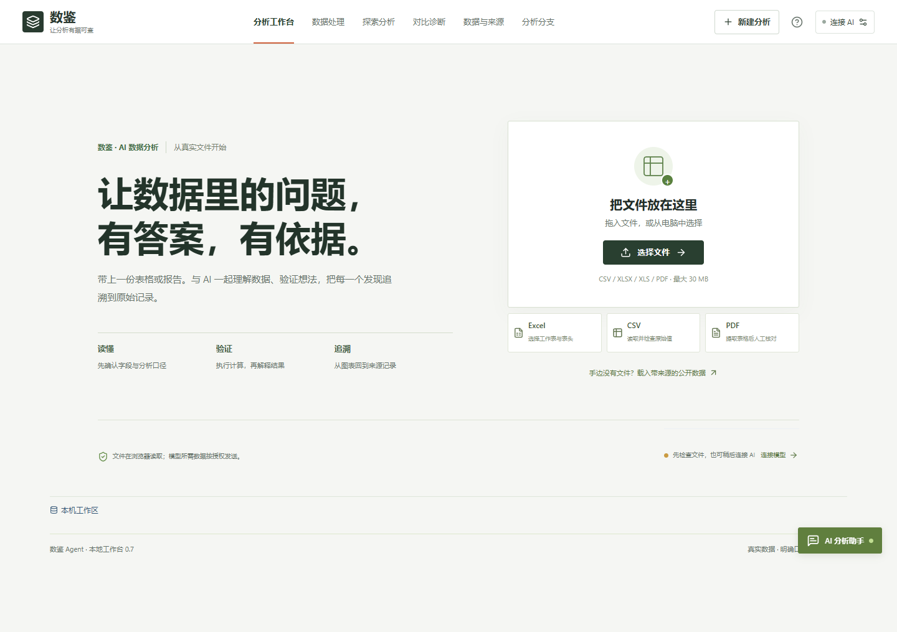
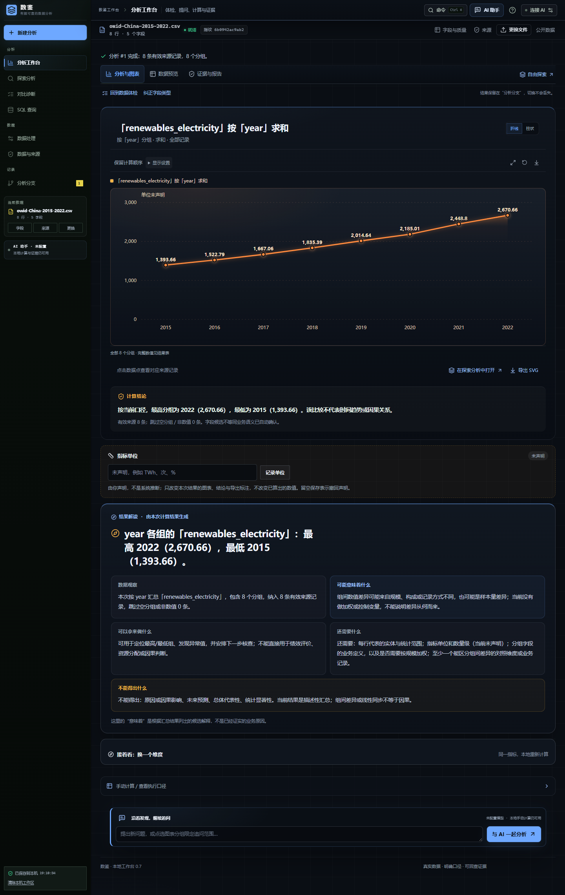
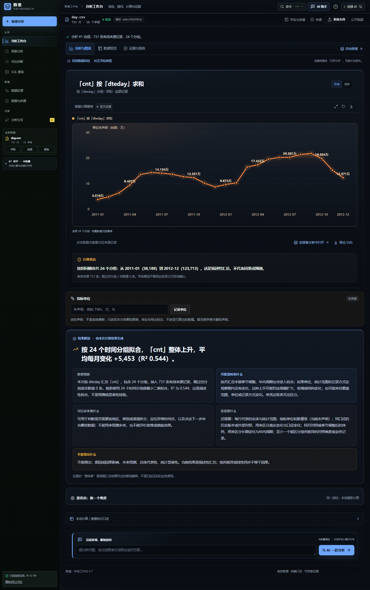

# 数鉴 Agent

让数据里的问题，有答案，有依据。面向真实文件的 AI 数据分析与可视化 Web 应用。

[](https://github.com/chenxuanmo123-ops/sui/actions/workflows/verify.yml)

上传表格或 PDF，与 AI 一起明确分析目标，执行真实 SQL，从图表追溯到计算口径和原始记录，再导出带证据的报告。初始工作区为空，使用用户上传或注明出处的公开数据。

## 界面预览





截图取自实际运行界面：导入后的本地数据体检，以及 OWID 中国 2015—2022 年可再生能源发电量的真实计算与确定性解读。解读由结果规则生成，不是 AI 输出；数据出处见[来源说明](docs/数据出处与引用说明.md)。

## 真实公开数据试跑

2026-10-24 用 UCI Bike Sharing 的 [day.csv](https://archive.ics.uci.edu/dataset/275/bike+sharing+dataset)（731 天、16 字段、2011-01-01–2012-12-31）本地跑通：体检识别 7 个数值指标、5 个分类维度、2 个二值结果和 1 个时间字段；按月求和 24 组共 3,292,679 次，线性拟合 +5,453/月（精确 5,452.9387）、R² 0.544；Pearson(`cnt`,`temp`)=0.6275（731 对）。逐月合计与相关系数由独立 Python 复算一致。页面数字全部来自真实 SQLite 与确定性规则。



来源、SHA-256、字段口径、复算命令与「不能得出什么」见[真实数据演示说明](docs/real-demo/演示说明.md)。

## 核心能力

| 功能 | 支持 |
| --- | --- |
| 文件导入 | CSV、XLSX、XLS、PDF；自动识别工作表、表头与范围；标题行或错位列可在同一预览里调整 |
| 数据处理 | 字段类型与质量检查、清理记录、撤销与工作区恢复 |
| 数据体检 | 按取值识别时间、数值、分类、二值、编号与文本字段，给出完整度、重复候选与可直接执行的问题 |
| 字段角色纠正 | 体检判错时可在本地改正；只提供数据支持的选项，不改原值，也不改已算结果 |
| 真实计算 | 浏览器 Worker 内运行 SQLite：求和、均值、中位数、P25/P75、计数、去重、最值，保留口径与 SQL |
| 结果解读 | 先给数据观察、可能含义、可用方向、还需要什么、不能得出什么；由结果规则生成，不调用模型 |
| 换维度对照 | 同一指标换一个分组字段在本地重算，含解读、图表、结果表、来源记录与 SQL |
| 分析分支 | 每次计算独立保留，可切换、重命名；删除时一并移除依赖它的追问与分析 |
| AI 辅助 | 分析计划、散点与相关、双维度热力图、占比饼图、结果解读与追问；最多四轮上下文，只发送问题与真实计算摘要 |
| SQL 查询 | 只读控制台：单条 SELECT/WITH，可 JOIN 会话内上传的第二张 CSV，结果可绘柱形或折线 |
| 指标单位 | 结果卡声明单位，只影响图表、结论与导出标注，不参与计算 |
| 证据与交付 | 原始记录回查、单文件 HTML 报告、可复现 SQL 包（CSV + schema + SQL + 预期结果 + Python 复跑） |

使用流程：**导入并体检 → 选择建议问题或连接 AI → 确认口径并计算 → 先读解读，再看图表与证据 → 换维度对照、追问或导出报告**。

几个边界：折线趋势是按年/月的描述性最小二乘拟合，散点相关系数是全范围 Pearson，热力图按两个维度交叉聚合、缺失组合留空，饼图只对可加总的求和或记录数计算占比——它们都描述已发生的数据，不做预测、显著性检验或因果推断。SQL 控制台拒绝写操作、多语句、参数与内部表。本地资料检索是 BM25 词法检索，不是向量检索，只发送命中摘录。

首次访问或手边没有文件时，可点「载入随应用附带的真实示例」直接使用 UCI Bike Sharing `day.csv`（731 天、16 字段）。它是随应用附带的逐字节副本，载入前核对 SHA-256，随后在浏览器本地完成体检、计算与图表。示例只降低上手门槛，不改变「数字必须来自计算」的规则。

## 在线部署

**当前状态：前端与同源 AI 接口已部署到 Cloudflare Pages：<https://sui-ae9.pages.dev/>**

`/api/ai/*`、`/api/health` 由 `functions/api/` 处理，与 Node 服务共用同一套计划校验、证据绑定、拒绝规则与限流。模型凭据只写在 Cloudflare 环境变量（`LLM_BASE_URL`、`LLM_API_KEY`、`LLM_MODEL`），浏览器拿不到密钥。2026-11-07 实测 `/api/health` 返回 `aiConfigured:true`，公网模型（DeepSeek `deepseek-chat`）可正常生成计划与通用知识回答。

[](https://render.com/deploy?repo=https://github.com/chenxuanmo123-ops/sui)

Render 方案保留为完整 Node 服务备选，模型同样通过云平台环境变量配置。两种部署的配置项、限制与验收步骤见[部署指南](docs/部署与交付.md)。

## 本地开发

需要 Node.js 24.16+（24 系列）。

```sh
git clone https://github.com/chenxuanmo123-ops/sui.git
cd sui
npm ci
npm run dev
```

打开终端显示的地址。模型可在本机网页中配置，或使用 [.env.example](.env.example)；未配置模型时仍可导入与手动计算。字段与验证步骤见[分析模型配置](docs/分析模型配置.md)，操作见[使用指南](docs/使用指南.md)。

## 技术架构

React + TypeScript + Vite 前端；sql.js 在浏览器 Worker 中执行计算；ECharts 与 SVG 展示结果；SheetJS / PDF.js 解析文件；Node.js 同源接口连接 OpenAI 兼容 Chat Completions 服务。

原文件在浏览器处理，模型所需的元数据、样本或文档图像按授权发送。部署者密钥只留在服务端；浏览器工作区保存在当前设备与站点，不跨设备同步。

## 文档与验证

- [使用指南](docs/使用指南.md) · [演示与讲解手册](docs/演示与讲解手册.md) · [技术文档](docs/技术文档.md) · [部署指南](docs/部署与交付.md) · [数据来源](docs/数据出处与引用说明.md) · [文档索引](docs/README.md)
- GitHub Actions 检查构建、核心计算、评测契约、AI 接口与生产路由。测试替身与真实模型验收分别记录，自动测试通过不代表模型对所有数据都准确。
- 当前单文件上限 30 MB。PDF 提取后需核对，复杂扫描件与任意规模数据尚未覆盖。SQL 控制台的 JOIN 仅限会话内另行上传的第二张 CSV。通用自主 Agent 调度与向量 RAG 尚未完成，MCP 暂缓。

维护账号：[chenxuanmo123-ops](https://github.com/chenxuanmo123-ops)。
