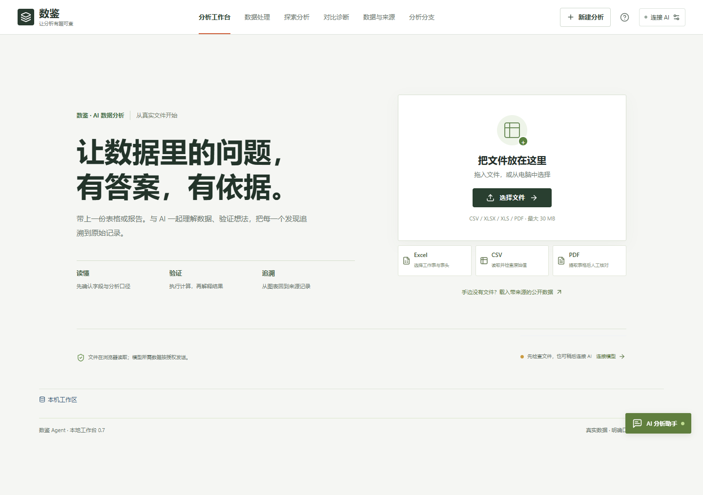
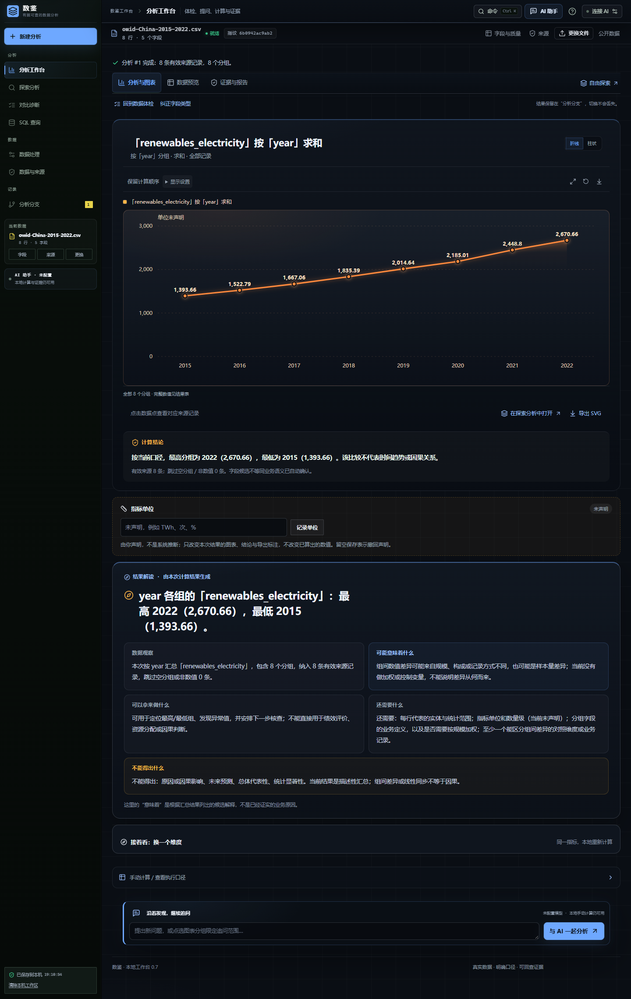

# 数鉴 Agent

让数据里的问题，有答案，有依据。面向真实文件的 AI 数据分析与可视化 Web 应用。

[](https://github.com/chenxuanmo123-ops/sui/actions/workflows/verify.yml)

上传表格或 PDF，与 AI 一起明确分析目标，执行真实 SQL，从图表追溯到计算口径和原始记录，再导出带证据的报告。初始工作区为空，使用用户上传或注明出处的公开数据。

## 界面预览





截图来自实际运行界面。结果图使用 UCI Online Shoppers 数据进行手动分组计算，不代表 AI 输出；数据出处见[来源说明](docs/数据出处与引用说明.md)。

## 核心能力

| 功能 | 当前支持 |
| --- | --- |
| 文件导入 | CSV、XLSX、XLS、PDF；工作表、表头、范围和 PDF 提取内容核对 |
| 数据处理 | 字段类型与质量检查、清理记录、撤销与工作区恢复 |
| AI 辅助 | OpenAI 兼容模型接入、初步定位、分析计划、结果解读与范围追问 |
| 真实计算 | 浏览器 Worker 中运行 SQLite；求和、均值、中位数、P25/P75、计数、去重、最值，保留计算口径与 SQL |
| 交互可视化 | 任务切换、分组选择、图表与明细联动、分析路径对照 |
| SQL 查询 | 只读控制台：在当前快照上执行单条 SELECT/WITH，使用真实表头或 cN，支持三个 UDF；可上传会话级第二张 CSV 做 JOIN；结果可绘成柱形/折线图（只画真实数值列，不重新聚合）；写操作、多语句、参数与内部表被拒绝 |
| 证据与交付 | 来源备注、原始记录回查、单文件 HTML 报告导出；可复现 SQL 包（清洗后 CSV + schema + SQL + 预期结果 + 本地 Python 复跑） |

使用流程：**导入并核对 → 连接 AI → 明确问题与授权 → 确认计划并计算 → 查看图表与证据 → 追问或导出报告**。

## 在线部署

**当前状态：前端已部署到 Cloudflare Pages：<https://sui-ae9.pages.dev/>；同源 AI 接口以 Pages Functions 随仓库部署。**

`/api/ai/*`、`/api/health` 由 `functions/api/` 处理，与 Node 服务共用同一套计划校验、证据绑定、拒绝规则和限流；模型配置只能写在 Cloudflare 环境变量（`LLM_BASE_URL`、`LLM_API_KEY`、`LLM_MODEL`），浏览器拿不到密钥。当前线上尚未配置模型，`/api/health` 返回 `aiConfigured:false`：导入、浏览器内计算和图表可用，AI 计划与解读不可用；配置后运行 `npm run verify:public` 核对。

[](https://render.com/deploy?repo=https://github.com/chenxuanmo123-ops/sui)

Render 方案保留为完整 Node 服务备选；默认模型同样通过云平台环境变量配置，费用与额度由部署者承担。两种部署的配置项、限制与验收步骤见[部署指南](docs/部署与交付.md)。

## 本地开发

需要 Node.js 24.16+（24 系列）。

```sh
git clone https://github.com/chenxuanmo123-ops/sui.git
cd sui
npm ci
npm run dev
```

打开终端显示的地址。AI 可在本机网页中配置，或使用 [.env.example](.env.example)；未配置模型时仍可导入与手动计算。更多操作见[使用指南](docs/使用指南.md)。

## 技术架构

React + TypeScript + Vite 前端；sql.js 在浏览器 Worker 中执行计算；ECharts 与 SVG 展示结果；SheetJS / PDF.js 解析文件；Node.js 同源接口连接 OpenAI 兼容 Chat Completions 服务。

原文件在浏览器处理，模型所需的元数据、样本或文档图像按授权发送。部署者密钥仅留在服务端；浏览器工作区保存在当前设备和站点，不跨设备同步。

## 文档与验证

- [使用指南](docs/使用指南.md) · [部署指南](docs/部署与交付.md) · [数据来源](docs/数据出处与引用说明.md) · [比赛规则与评分标准](docs/比赛规则与评分标准-2026.md)
- [文档索引](docs/README.md)：当前说明、历史 PRD、开源调研与分阶段验收记录。
- GitHub Actions 检查构建、核心计算、评测契约、AI 接口与生产路由。测试替身与真实模型验收分别记录，自动测试通过不代表模型对所有数据都准确。

当前单文件上限 30 MB。PDF 提取后需核对，复杂扫描件和任意规模数据尚未覆盖。SQL 控制台的多表 JOIN 仅限会话内另行上传的第二张 CSV，不会自动进入分析流水线或证据链。通用自主 Agent 调度、多假设验证和 RAG 尚未完成，MCP 暂缓。

维护账号：[chenxuanmo123-ops](https://github.com/chenxuanmo123-ops)。参赛团队的正式名称、成员、学校与分工待补充。
