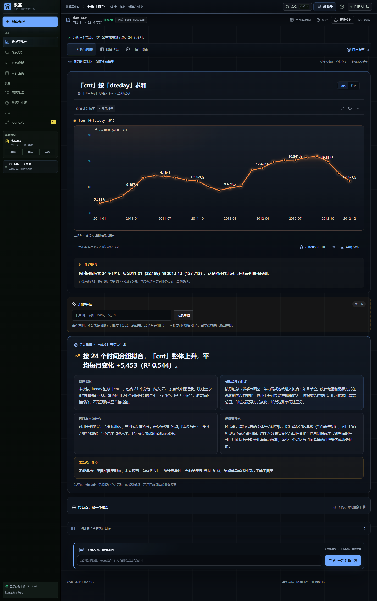

# 数鉴 Agent

让数据里的问题，有答案，有依据。面向真实文件的 AI 数据分析与可视化 Web 应用。

[](https://github.com/chenxuanmo123-ops/sui/actions/workflows/verify.yml)

上传表格或 PDF，与 AI 一起明确分析目标，执行真实 SQL，从图表追溯到计算口径和原始记录，再导出带证据的报告。初始工作区为空，使用用户上传或注明出处的公开数据。

## 界面预览


截图来自实际运行界面：第一张是导入后的本地数据体检，第二张是 OWID 中国 2015—2022 年可再生能源发电量的真实计算与确定性解读。解读由结果规则生成，不代表 AI 输出；数据出处见[来源说明](docs/数据出处与引用说明.md)。

## 真实公开数据试跑

2026-10-24 用 UCI Bike Sharing 的 [day.csv](https://archive.ics.uci.edu/dataset/275/bike+sharing+dataset)（731 天、16 字段、2011-01-01–2012-12-31）在本地完整跑通：体检识别 7 个数值指标、5 个分类维度、2 个二值结果和 1 个时间字段；按月求和 24 组共 3,292,679 次，线性拟合 +5,453/月（精确 5,452.9387）、R² 0.544；Pearson(`cnt`,`temp`)=0.6275（731 对）。逐月合计与相关系数由独立 Python 复算一致。模型接口固定为未配置，页面数字与解读全部来自真实 SQLite 与确定性规则。



来源、SHA-256、字段口径、复算命令与“不能得出什么”见[真实数据演示说明](docs/real-demo/演示说明.md)。

## 核心能力

| 功能 | 当前支持 |
| --- | --- |
| 文件导入 | CSV、XLSX、XLS、PDF；工作表、表头、范围和 PDF 提取内容核对；CSV 首行不能作表头（标题行、列数不齐、重复列名）时进入同一预览选择表头与截止行，标准 CSV 仍一步导入 |
| 数据处理 | 字段类型与质量检查、清理记录、撤销与工作区恢复；替换非空工作区前先确认，避免误清分析路径 |
| 数据体检 | 导入后按取值识别时间、数值、分类、二值结果、编号与文本字段，给出完整度、重复候选和可直接执行的问题；不需要先懂字段类型或聚合方式 |
| 字段角色纠正 | 体检判错时可在本地改正（数值 / 时间 / 分类 / 二值 / 编号 / 文本）；只提供数据实际支撑的选项，无法解析为数值的列不能声明成指标，裸年份列经确认后才能当时间字段；纠正随本机工作区保存，不修改原始值，也不改写已算出的结果 |
| 结果解读 | 先给“数据观察 / 可能意味着什么 / 可以拿来做什么 / 还需要什么 / 不能得出什么”，全部由真实结果规则生成，不调用模型；AI 只补充带事实编号的可能含义与用途 |
| 换维度对照 | 结果页提供“接着看”：用同一指标、筛选与汇总方式换一个分组字段（时间或分类），在本地重新计算并弹出对照面板，含解读、图表、结果表、来源记录与 SQL；不需要懂字段配置，也不调用模型 |
| 分析分支 | 每次计算保留独立结果，可切换、重命名；删除前确认，并一并移除追问结果和包含它们的 AI 分析，避免解读引用指向已删除的结果 |
| AI 辅助 | OpenAI 兼容模型接入、初步定位、分析计划、散点与相关性、双维度热力图、单维占比饼图、结果解读与范围追问；已完成轮次可作为对话上下文继续追问（最多四轮，只发送问题、计划标题与该轮真实计算摘要，历史不作为新证据）；体检中确认过的字段类型会作为已确认用法发送给模型（不改变业务含义判断）；本地资料检索：上传 PDF/TXT/Markdown 或使用内置方法提示，只发送命中摘录，解读引用编号经服务端校验 |
| 真实计算 | 浏览器 Worker 中运行 SQLite；求和、均值、中位数、P25/P75、计数、去重、最值，保留计算口径与 SQL；按年/月分桶的折线给出描述性线性趋势（平均每期变化、R²），散点图给出全范围 Pearson 相关系数（r、有效配对数），热力图按两个真实分组维度交叉聚合、缺失组合留空不补零，饼图只对可加总的求和或记录数计算当前筛选范围内的分组占比（含负数或全为 0 时拒绝绘制），都不是预测、显著性检验或因果结论 |
| 交互可视化 | 任务切换、分组选择、图表与明细联动、分析路径对照 |
| SQL 查询 | 只读控制台：在当前快照上执行单条 SELECT/WITH，使用真实表头或 cN，支持三个 UDF；可上传会话级第二张 CSV 做 JOIN；结果可绘成柱形/折线图（只画真实数值列，不重新聚合）；写操作、多语句、参数与内部表被拒绝 |
| 指标单位 | 在结果卡声明指标单位（如 TWh、亿元、次）；单位只改图表、结论与导出标注，不参与 SQL 或数值计算；分析计划自带的单位显示为“口径单位”，只有明确确认后才记为用户声明，并随本机工作区保存 |
| 证据与交付 | 来源备注、原始记录回查、单文件 HTML 报告导出；可复现 SQL 包（清洗后 CSV + schema + SQL + 预期结果 + 本地 Python 复跑） |

使用流程：**导入并体检 → 选择系统建议的问题或连接 AI → 确认口径并计算 → 先读解读，再看图表与证据 → 换维度对照、追问或导出报告**。

首次访问或手边没有文件时，可点「载入随应用附带的真实示例」直接使用 UCI Bike Sharing `day.csv`（731 天、16 字段）。它是随应用附带的逐字节副本，载入前核对 SHA-256，随后在浏览器本地完成体检、真实 SQL 计算与图表；示例只降低上手门槛，不改变“数字必须来自计算”的规则。

## 在线部署

**当前状态：前端已部署到 Cloudflare Pages：<https://sui-ae9.pages.dev/>；同源 AI 接口以 Pages Functions 随仓库部署。**

`/api/ai/*`、`/api/health` 由 `functions/api/` 处理，与 Node 服务共用同一套计划校验、证据绑定、拒绝规则和限流；模型配置只能写在 Cloudflare 环境变量（`LLM_BASE_URL`、`LLM_API_KEY`、`LLM_MODEL`），浏览器拿不到密钥。线上服务端模型已配置，`/api/health` 返回 `aiConfigured:true`（DeepSeek `deepseek-chat`）；但该上游账号目前没有余额，真实计划请求会收到 `HTTP 402：账户余额不足`，所以公网的自然语言功能在充值前仍不可用。导入、浏览器内计算、手动分析与图表始终可用。充值后用浏览器打开线上地址提交一句分析问题，确认返回计划卡，再运行 `npm run verify:public` 核对公开接口与限流。

[](https://render.com/deploy?repo=https://github.com/chenxuanmo123-ops/sui)

Render 方案保留为完整 Node 服务备选；默认模型同样通过云平台环境变量配置，费用与额度由部署者承担。两种部署的配置项、限制与验收步骤见[部署指南](docs/部署与交付.md)。

## 本地开发

需要 Node.js 24.16+（24 系列）。

```sh
git clone https://github.com/chenxuanmo123-ops/sui.git
cd sui
npm ci
npm run dev
```

打开终端显示的地址。AI 可在本机网页中配置，或使用 [.env.example](.env.example)；未配置模型时仍可导入与手动计算。具体字段与验证步骤见[分析模型配置](docs/分析模型配置.md)，更多操作见[使用指南](docs/使用指南.md)。

## 技术架构

React + TypeScript + Vite 前端；sql.js 在浏览器 Worker 中执行计算；ECharts 与 SVG 展示结果；SheetJS / PDF.js 解析文件；Node.js 同源接口连接 OpenAI 兼容 Chat Completions 服务。

原文件在浏览器处理，模型所需的元数据、样本或文档图像按授权发送。部署者密钥仅留在服务端；浏览器工作区保存在当前设备和站点，不跨设备同步。

## 文档与验证

- [使用指南](docs/使用指南.md) · [演示与讲解手册](docs/演示与讲解手册.md) · [技术文档](docs/技术文档.md) · [演示数据索引](demo-data/README.md) · [部署指南](docs/部署与交付.md) · [数据来源](docs/数据出处与引用说明.md) · [比赛规则与评分标准](docs/比赛规则与评分标准-2026.md)
- [文档索引](docs/README.md)：当前说明、历史 PRD、开源调研与分阶段验收记录。
- GitHub Actions 检查构建、核心计算、评测契约、AI 接口与生产路由。测试替身与真实模型验收分别记录，自动测试通过不代表模型对所有数据都准确。

当前单文件上限 30 MB。PDF 提取后需核对，复杂扫描件和任意规模数据尚未覆盖。SQL 控制台的多表 JOIN 仅限会话内另行上传的第二张 CSV，不会自动进入分析流水线或证据链。参考资料检索是浏览器内的词法 BM25（中文二元组 + 英文单词），不是向量语义检索；只发送命中摘录，资料不进入数据快照、证据链或报告，刷新或更换数据后清空。时间趋势是对图中聚合时间点的描述性最小二乘拟合，不做预测、显著性检验或因果推断，时间点缺失或不等距会直接影响斜率。Pearson 相关系数按当前筛选下全部有效配对计算，只衡量线性同步程度；极端值、非线性关系和共同趋势会影响数值，图中点数受展示上限限制，与系数覆盖范围可能不同。通用自主 Agent 调度与向量 RAG 尚未完成，MCP 暂缓。

维护账号：[chenxuanmo123-ops](https://github.com/chenxuanmo123-ops)。参赛团队的正式名称、成员、学校与分工待补充。
