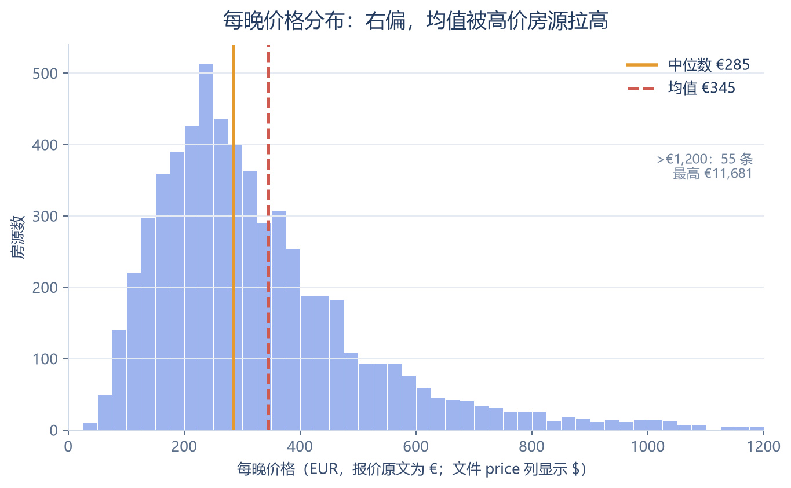
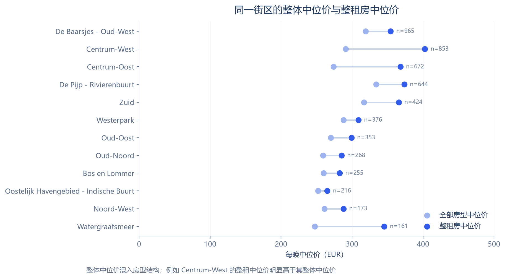
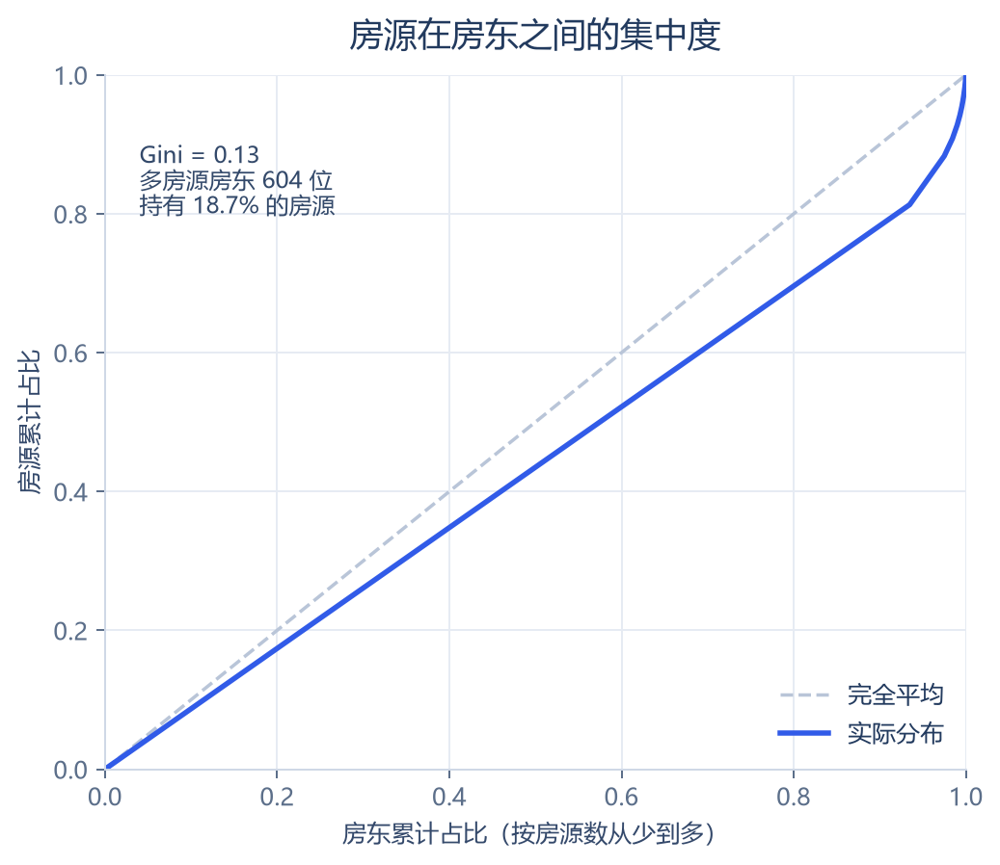
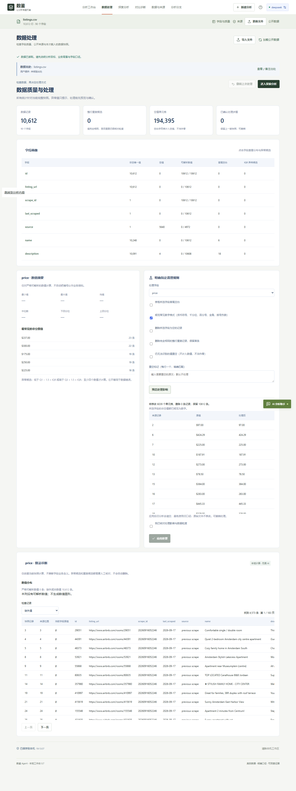
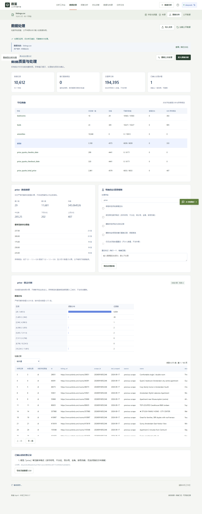
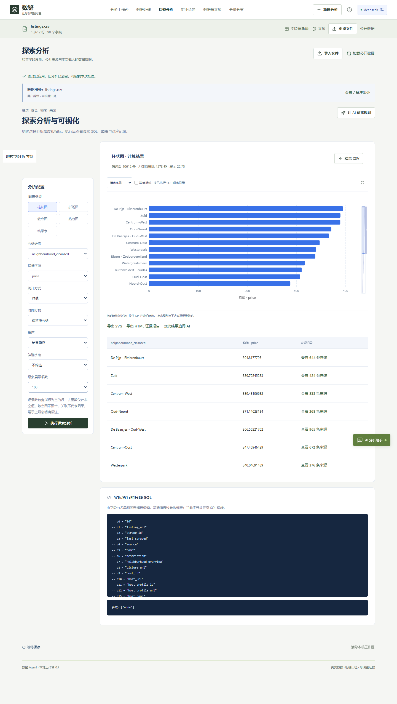

# 阿姆斯特丹 Airbnb 房源价格分析

> 数据：Inside Airbnb，Amsterdam，快照 2026-09-16，CC BY 4.0。原始文件 `listings.csv`，10,612 行 × 90 列。
> 下载：2026-10-23，SHA-256 `d6eabb54c664de6d10ee5709e71e2cb194f093d1d9777518f654bf3e45444ffe`。
> 来源：<https://data.insideairbnb.com/the-netherlands/north-holland/amsterdam/2026-09-16/data/listings.csv.gz>
> 复现：`python -I scripts/real-data-analysis/airbnb_amsterdam.py`

## 我会怎么分析

这份数据容易直接算“平均房价”，但那会同时犯三个错误：把缺失当随机、把不同房型混在一起、让极端值拉高均值。下面的顺序是：**先确认口径与完整性 → 显式规范化字段 → 用稳健统计量描述 → 分层复核 → 再谈结论边界**。

### 1. 先确认一行代表什么

一行是一个 Airbnb 房源，不是一次入住，也不是一笔成交。`price` 不是房源标价，而是抓取时针对某组具体日期生成的**报价**（`price_quote_checkin_date` 到 `price_quote_checkout_date`），并可能包含折扣；`price_quote_price_per_night` 是同一报价的每晚数值。因此这里算的是“抓取时有报价房源的每晚报价”，不是全年平均成交价，也不是平台整体均价。

`price` 列写成 `$97.00`，但 `price_quote_raw` 里的 `currency` 明确是 **EUR**。货币符号不能当作币种证据；本文按报价原文的 EUR 展示，不做汇率换算。

### 2. 先查完整性，不先算均值

- 价格非空 6,039 条，空值 4,573 条，覆盖率 **56.9%**。
- 价格格式：6,039 条 `$` 金额全部解析成功，失败 0 条；与文件自带的数值列逐条比对 **6,033/6,033 一致**（差异 >€0.005 的记录 0 条）。这是字段级校验，不是模型判断。
- 价格缺失不是随机的：

| 可租天数 | 记录数 | 有报价 | 覆盖率 | 中位价 |
| --- | --- | --- | --- | --- |
| 0 天 | 4,460 | 260 | 5.8% | €169 |
| 1–30 天 | 1,347 | 1,096 | 81.4% | €301 |
| 31–90 天 | 1,123 | 1,099 | 97.9% | €285 |
| 91–180 天 | 1,063 | 1,044 | 98.2% | €287 |
| 181–365 天 | 2,619 | 2,540 | 97.0% | €290 |

可租天数为 0 的房源中，94.2% 没有报价；可租 31 天以上的房源中，约 97%–98% 有报价。**所以价格分析只覆盖“当前有可租日期且有报价”的房源，不能外推到全部 10,612 条房源，更不能外推到阿姆斯特丹整体租赁市场。**

### 3. 价格分布：右偏，用中位数和四分位距

有报价房源 6,039 条：

- 中位数 **€285** / 晚，四分位距 **€202–€407**。
- 均值 €345 / 晚，高于中位数；第 95 百分位 €742，第 99 百分位 €1,173。
- 最高 €11,681 / 晚；超过 €500 的 895 条，超过 €1,000 的 112 条，超过 €3,000 的只有 7 条。
- 没有 0 或负价格。极端值不删除，但在图中截断展示；均值对它们敏感，所以主结论用中位数。



### 4. 分层：房型与卧室数

| 房型 | 有报价记录 | 中位价 | 均值 |
| --- | --- | --- | --- |
| Entire home/apt | 4,320 | €332 | €401 |
| Private room | 1,674 | €176 | €205 |
| Hotel room | 23 | €190 | €227 |
| Shared room | 22 | €64 | €93 |

整租中位价 €332，独立房间 €176，前者约为后者的 1.89 倍。酒店房间和合住房间的样本分别只有 23 和 22 条，不据此下结论。

| 卧室数（仅整租） | 有报价记录 | 中位价 |
| --- | --- | --- |
| 1 卧 | 2,309 | €281 |
| 2 卧 | 1,226 | €413 |
| 3 卧 | 510 | €439 |
| 4 卧 | 160 | €558 |

即使同为整租，卧室数从 1 增加到 4，中位价也从 €281 升到 €558。**所以比较街区时必须控制房型/卧室数，否则比到的是房源结构，不是地段溢价。**

### 5. 街区：整体排名会被房型结构扭曲

| 街区 | 有报价记录 | 整体中位价 | 整租记录 | 整租中位价 |
| --- | --- | --- | --- | --- |
| De Baarsjes - Oud-West | 965 | €319 | 794 | €354 |
| Centrum-West | 853 | €291 | 440 | €403 |
| Centrum-Oost | 672 | €274 | 369 | €368 |
| De Pijp - Rivierenbuurt | 644 | €334 | 527 | €374 |
| Zuid | 424 | €317 | 321 | €366 |
| Westerpark | 376 | €288 | 324 | €309 |
| Oud-Oost | 353 | €270 | 272 | €299 |
| Oud-Noord | 268 | €259 | 200 | €285 |
| Bos en Lommer | 255 | €260 | 226 | €282 |
| Oostelijk Havengebied - Indische Buurt | 216 | €252 | 166 | €265 |
| Noord-West | 173 | €261 | 141 | €288 |
| Watergraafsmeer | 161 | €247 | 109 | €345 |

按“全部房型”的中位价，De Pijp–Rivierenbuurt、De Baarsjes–Oud-West、Zuid 靠前；但把范围收窄到整租房后，Centrum-West 从 €291 升到 €403，排名上升。原因是中心区独立房间占比更高，拉低了“全部房型”的中位数。



这仍然只是描述性比较：没有控制卧室数、面积、设施、评分和具体日期，也没有做显著性检验。下一步应按“整租 + 同卧室数”分层，或做回归/匹配，而不是直接说“某街区更贵”。

### 6. 供给集中度与许可证

- 9,231 位房东持有 10,612 条房源；前 10 位持有 169 条（1.6%），前 100 位持有 796 条（7.5%）。
- 持有 2 条及以上房源的房东 604 位，合计 1,985 条（18.7%）。Gini = 0.13。
- 许可证字段：缺失 466 条（4.4%）; 标记 Exempt 605 条（5.7%）; 有许可证编号 9,541 条（89.9%）。许可证缺失和 `Exempt` 的含义不同，不能把缺失直接当成“无证”。



### 7. 我检查过但没有写成结论的关系

- 价格与评分（Spearman）0.29；价格与可租天数 0.09；价格与最少入住晚数 0.15。
- 这些是相关，不是因果。房型、卧室数、地段和日期会同时影响价格与这些变量；没有控制变量前，不写“评分高所以更贵”或“可租天数少所以更贵”。

### 8. 这份分析不能回答什么

- 不能回答“阿姆斯特丹 Airbnb 的平均价格”，因为 4,573 条没有报价，且缺失与可租状态强相关。
- 不能回答“某街区涨价/降价”，因为只有一个快照。
- 不能回答“某房源的实际收入”，因为没有订单数据；`estimated_revenue_l365d` 是平台估算，不是结算记录。
- 不能回答“许可证是否合规”，因为 `Exempt`、缺失和编号需要与市政登记规则匹配后才能判断。
- 不能把不同日期的报价直接比较；报价对应的入住日期不同，季节性和提前预订折扣未控制。

## 如果放进数鉴 Agent

1. 导入 `listings.csv`，先看字段画像：`price` 的非空唯一值、空值、可解析数值、首尾空白。
2. 在“明确指定清理规则”里选择 `price`，勾选“规范常见数字格式”，预览会显示 **6,039 个单元格修改、0 个无法识别**；应用后 `price` 变成可计算的数值字段，并记录处理步骤与父快照。
3. 手动口径：分组 `neighbourhood_cleansed`，指标 `price`，聚合先看计数和均值；结果表可搜索、排序，图表可回查原始记录。
4. 当前聚合选项没有中位数；这份报告的中位数由同一份原始文件在 Python 中独立计算，并用 `price_quote_price_per_night` 交叉校验。若要把“中位数”作为产品能力，需要扩展聚合类型，而不是在界面文案里假装支持。

以下截图由 Playwright 驱动 Microsoft Edge，在数鉴 Agent 中直接导入这份 26 MB CSV 后生成，未修改界面或数据：



*清理预览：6,039 个单元格将被规范化，0 个无法识别；应用前即可看到影响范围。*



*应用后 `price` 成为数值字段，画像显示 6,039 / 6,039 可解析，并保留处理步骤。*



*按 `neighbourhood_cleansed` 分组、`price` 求均值得到 22 个街区；这是均值，不是上面报告采用的中位数。*

## 复现与校验

```sh
python -I scripts/real-data-analysis/airbnb_amsterdam.py
```

- 原始数据 SHA-256：`d6eabb54c664de6d10ee5709e71e2cb194f093d1d9777518f654bf3e45444ffe`
- 所有指标同时写入 `metrics.json`；图表在 `charts/`。
- 解析规则：只接受 `$` + 数字/千分位/小数；解析结果必须与 `price_quote_price_per_night` 在 €0.005 内一致后才用于统计。
