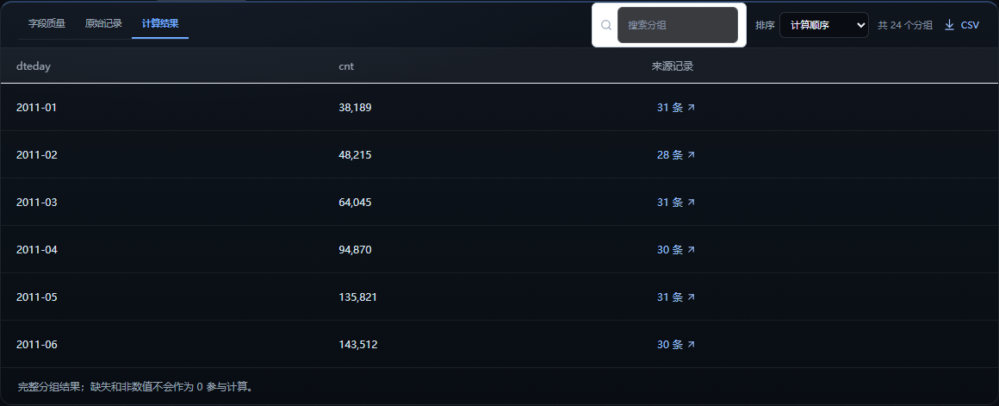
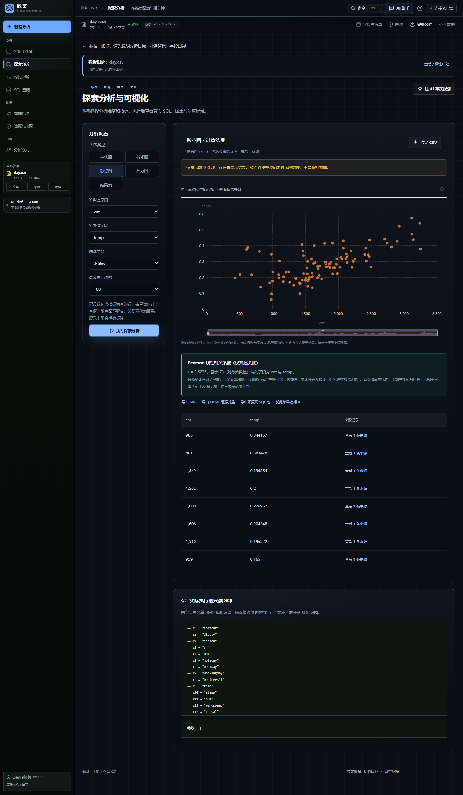

# 真实公开数据演示：UCI Bike Sharing（day.csv）

这份演示只使用网络上下载的真实公开数据，所有数字来自本地 SQLite / sql.js 计算。模型接口在演示时固定为“未配置”，因此页面上的体检、图表和五段解读全部来自确定性代码，不包含模型生成的数字。

## 1. 数据来源与文件

| 项目 | 内容 |
| --- | --- |
| 数据集 | UCI Machine Learning Repository · Bike Sharing Dataset |
| 页面 | <https://archive.ics.uci.edu/dataset/275/bike+sharing+dataset> |
| 直接下载 | <https://archive.ics.uci.edu/static/public/275/bike+sharing+dataset.zip> |
| 使用文件 | `day.csv`（按天汇总） |
| 记录数 | 731 天 |
| 字段数 | 16 |
| 时间范围 | 2011-01-01 至 2012-12-31 |
| 数据背景 | 美国华盛顿特区 Capital Bikeshare 2011–2012 年公开系统日志，作者补充天气与季节信息 |
| 引用 | Fanaee-T, H. & Gama, J. (2013). *Event labeling combining ensemble detectors and background knowledge.* Progress in Artificial Intelligence. doi:10.1007/s13748-013-0040-3 |
| ZIP SHA-256 | `b70182d0d0508e9abbb79306ce5c0cec34869000f8220175ac83d11dbe845401` |
| CSV SHA-256 | `a6bcf826782d3c0fbfdcbeead17cd0884185a0dafe8ff10cd48a874ee7ba18be` |

字段含义以数据集自带的 `Readme.txt` 为准。需要特别注意：

- `cnt` 是当天总租车次数，等于 `casual + registered`。
- `temp`、`atemp`、`hum`、`windspeed` 是归一化数值，不是原始摄氏度、百分比或风速；例如 `temp` 已除以 41。页面只按原始数值展示，不做单位换算。
- `season`、`weathersit`、`weekday` 等是数字编码。`weathersit` 在本文件中出现 1、2、3 三个编码，分别对应数据集说明里的晴/少云、雾/多云、小雨雪/雷阵雨等类别；系统不会自动把编码翻译成业务名称。
- 每行是一天，不是一次租车记录。

## 2. 数据体检结果

- 单元格完整度：100%，0 个空值单元格。
- 字段角色：7 个数值指标、5 个分类维度、2 个二值结果、1 个时间字段。
- `instant` 被识别为编号 / 标识，不进入指标和相关性候选。
- `dteday` 被识别为日期字段，覆盖 731 个日期。
- `cnt` 被识别为数值指标；体检给出 3 个可直接执行的问题：
  1. 按 `dteday` 看 `cnt` 怎么变化（按月汇总）。
  2. `weathersit` 之间，`cnt` 差多少。
  3. `cnt` 与 `temp` 是否同步变化。


## 3. 实际执行的分析

### 3.1 月度趋势

执行问题：**按 `dteday` 看 `cnt` 怎么变化**。口径是按月对 `cnt` 求和，共 24 个时间分组，纳入 731 条有效来源记录，跳过 0 条。

| 指标 | 结果 |
| --- | --- |
| 2011-01 | 38,189 |
| 2011-06 | 143,512 |
| 2011-12 | 87,323 |
| 2012-01 | 96,744 |
| 2012-09 | 218,573 |
| 2012-12 | 123,713 |
| 24 个月合计 | 3,292,679 |
| 最小二乘斜率 | 每月 +5,452.9387 |
| R² | 0.544 |

系统给出的标题是：**按 24 个时间分组拟合，cnt 整体上升，平均每月变化 +5,453（精确值 +5,452.9387，R² 0.544）**。界面按千分位取整显示，精确值以上表为准。

解读同时写明：按月汇总未做季节调整，年内周期也会进入拟合；如果单位、统计范围和记录方式没有变化，这种上升可能对应规模、结构或记录变化，也可能来自覆盖范围变化，单凭这张表无法区分。不能据此预测未来或评价措施效果。


完整 24 个分组的结果表：



### 3.2 `cnt` 与 `temp` 的线性同步程度

执行问题：**`cnt` 与 `temp` 是否同步变化**。使用全部 731 对有效数值计算 Pearson 相关系数，散点图按来源记录顺序展示前 100 项，图与系数覆盖范围不同已在页面注明。

| 指标 | 结果 |
| --- | --- |
| Pearson r | 0.6275 |
| 有效配对 | 731 |
| 无效值排除 | 0 |

系统明确标注：只衡量线性同步程度，不是因果结论、预测能力或显著性检验；极端值、非线性关系和共同时间趋势都会影响 r。`temp` 是归一化温度，不能把 r 解读成“每升高 1°C 增加多少辆”。



## 4. 独立核对

用独立 Python 脚本（只读 CSV，不经过应用代码）复算：

```bash
python -I docs/real-demo/verify_bike.py docs/real-demo/day.csv
```

核对结果：

- 731 行，2011-01-01 至 2012-12-31，数值列 0 个空值。
- 24 个月的 `cnt` 求和与页面结果表逐项一致。
- 2011 年合计 1,243,103；2012 年合计 2,049,576。
- Pearson(`temp`, `cnt`) = 0.627494，与页面 `0.6275` 一致。
- Pearson(`hum`, `cnt`) = -0.100659（此项未在页面展示，仅用于核对方向）。

页面截图见本目录 `screenshots/`，四张图都来自当前运行界面：导入后的体检、按月趋势与五段解读、24 个分组结果表、`cnt` 与 `temp` 的散点与相关系数。复跑应用界面需要在完整仓库中启动本地服务后导入本目录的 `day.csv`；独立核对只需上面的 Python 脚本，不经过应用代码。

## 5. 这次结果能说明什么，不能说明什么

可以说明（描述性）：

- 在这份 2011–2012 年的日数据中，按月求和的租车次数整体呈上升拟合，24 个月合计 3,292,679 次。
- 2012 年各月合计普遍高于 2011 年同月；例如 1 月从 38,189 升至 96,744，9 月从 127,418 升至 218,573。
- `cnt` 与归一化 `temp` 在这 731 天里呈中等程度的正向线性同步（r = 0.6275）。

不能说明：

- 不能说明温度升高导致租车增加；这是观测数据，未控制节假日、天气编码、季节、城市活动、系统扩容等共同因素。
- 不能把 `weathersit` 的编码直接当作业务类别名称；需要按数据集说明核对。
- 不能把“按 `weathersit` 分组的总量”当作天气影响：不同天气编码对应的天数不同，总量会受暴露天数影响。本次演示没有把该排名作为结论。
- 不能把 2011–2012 年华盛顿特区的结果外推到其他城市、其他年份或未来。
- 不能把 R² 0.544 或 r 0.6275 解读为预测准确率、显著性检验或因果效应。

## 6. 文件清单

| 路径 | 内容 |
| --- | --- |
| `bike-sharing/Bike-Sharing-Dataset.zip` | UCI 原始下载包 |
| `bike-sharing/extracted/day.csv` | 本次使用的 731 行日数据 |
| `bike-sharing/extracted/Readme.txt` | 数据集字段定义与引用 |
| `verify_bike.py` | 独立复算脚本 |
| `run_bike_demo.py` | 浏览器端真实执行脚本 |
| `report.json` | 页面提取的体检、趋势、相关性结果 |
| `screenshots/01-bike-checkup-1440.png` | 体检首屏 |
| `screenshots/02-bike-trend-1440.png` | 24 个月趋势与五段解读 |
| `screenshots/03-bike-trend-table.png` | 24 个分组结果表 |
| `screenshots/04-bike-correlation-1440.png` | 散点图与 Pearson 系数 |
