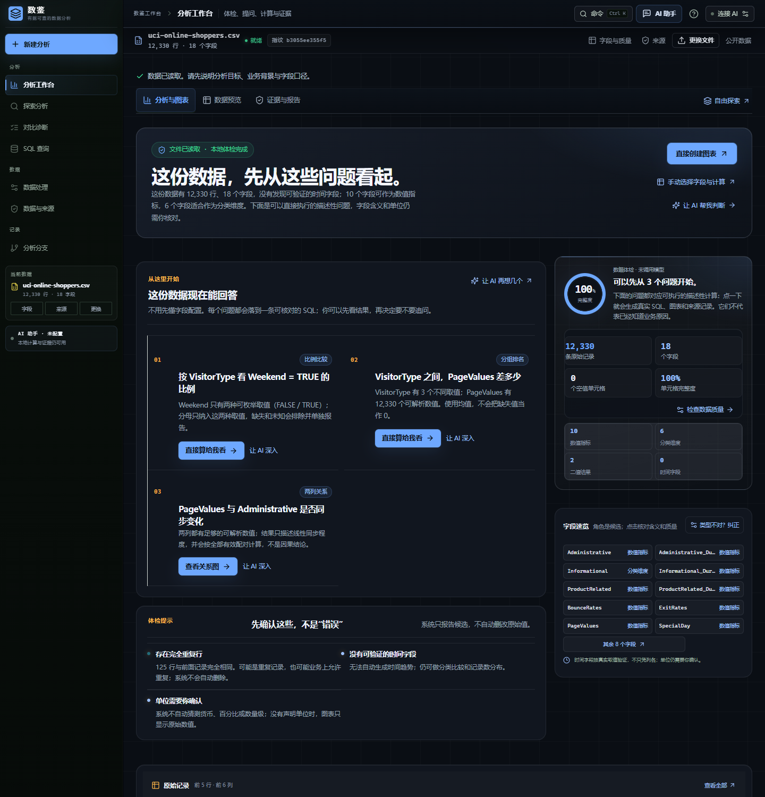
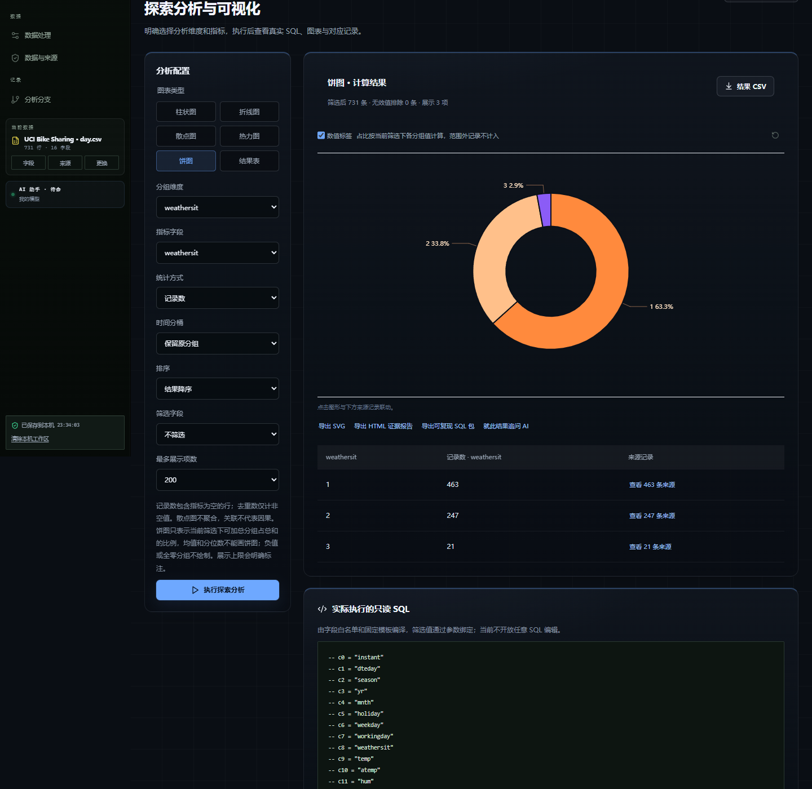
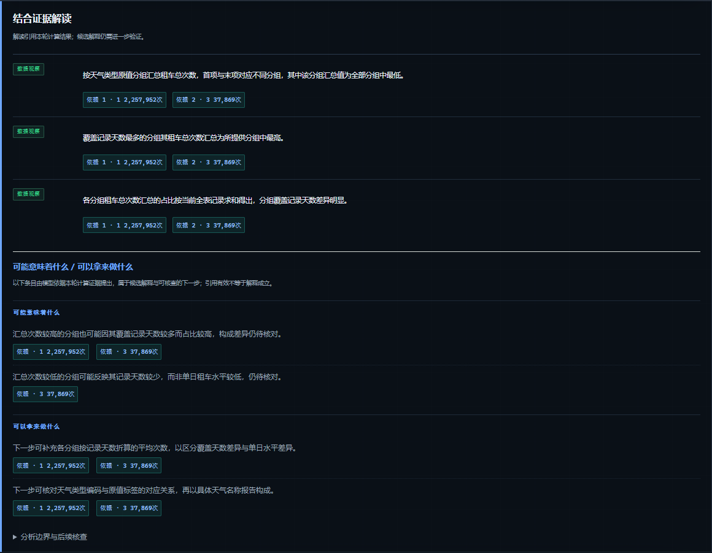
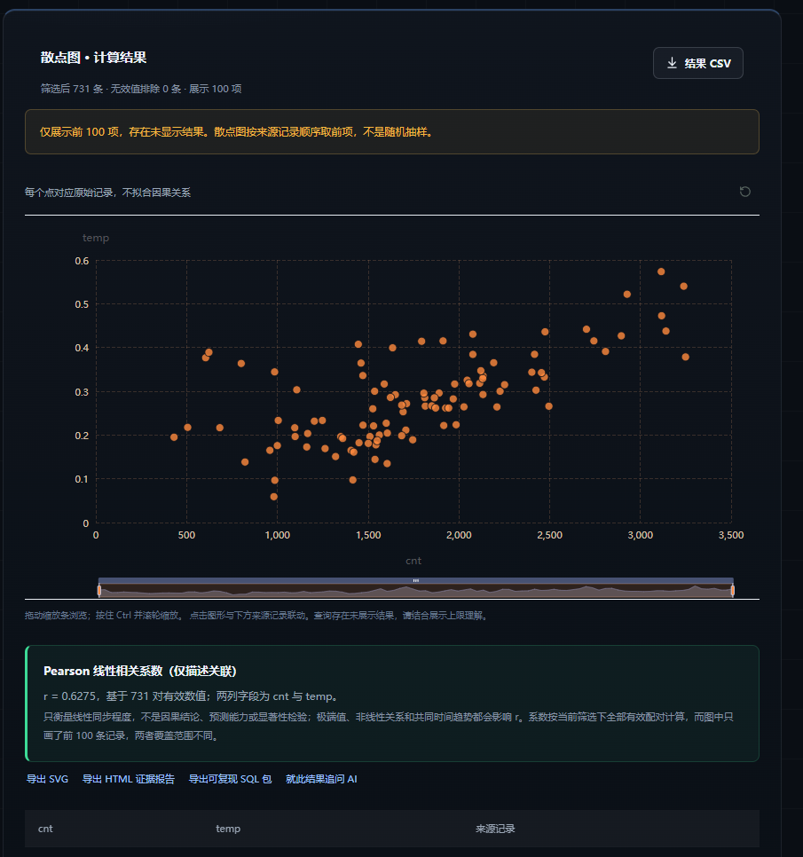
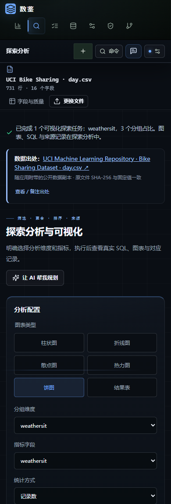

# 数鉴 Agent

**让数据里的问题，有答案，有依据。**

- **参赛赛道**：AI 数据分析与可视化（方向 8）
- **作品形态**：本地优先、证据绑定的 AI 数据分析 Web 应用
- **在线体验**：https://sui-ae9.pages.dev/
- **源码仓库**：https://github.com/chenxuanmo123-ops/sui
- **文档版本**：2026-10-31

## 一、项目详情及使用方式

### 1.1 项目是什么

数鉴 Agent 是一个面向真实文件的 AI 数据分析与可视化 Web 应用。用户上传 CSV、Excel 或 PDF，用自然语言提出分析问题；AI 把问题翻译成一份可核对的分析计划；用户确认口径后，应用在浏览器内置的 SQLite 中执行真实 SQL，输出图表、结果表、来源记录与实际执行的 SQL。

核心分工是明确的：**模型负责理解问题、规划口径和解释已经算出的结果，不负责产生数字**。页面上的每个数字都来自本地 SQL 计算，并可回查到原始记录与快照指纹。

> 一句话边界：样本不等于总体，描述性统计不写成因果结论，模型只解释已验证的事实。

### 1.2 使用方式（公网版，约 3 分钟）

1. 打开 https://sui-ae9.pages.dev/ 。页面右上角显示模型连接状态；未配置模型时，本地分析、SQL 控制台与确定性解读仍可使用。
2. 点击「载入随应用附带的真实示例（UCI 骑行日数据）」，或上传自己的 CSV / XLSX / XLS / PDF。示例 day.csv 为 731 行、16 列、2011-01-01 至 2012-12-31，载入时核对 SHA-256。
3. 阅读数据体检：字段角色、完整度、重复候选，以及可直接执行的问题建议。
4. 在「从这份数据中，你想了解什么？」输入问题，例如「各天气类型的租车总次数占比是多少？」，点击「与 AI 一起分析」。
5. 核对计划的任务类型、分组字段、指标字段、聚合方式、筛选条件与待确认口径；勾选「我已核对…允许按此计划计算」后点击「确认计划并计算」。
6. 查看结果：饼图、结果表、实际执行的只读 SQL、参数与来源记录；可切换图表、换维度、追问，或导出 CSV、SVG、HTML 证据报告与可复现 SQL 包。
7. 在结果页点击「就此结果追问 AI」，可携带本轮真实结果继续追问（最多四轮）。

也可以完全不使用 AI：在「探索分析」「对比诊断」「SQL 查询」中手动选择字段与聚合，得到同样的本地计算与证据链。

本地运行（可选）：需 Node.js 24.x，执行 `npm install` 与 `npm run dev`；模型经 OpenAI 兼容接口接入，密钥只放服务端或云平台环境变量。未配置密钥时，本地分析与确定性解读仍可用。

## 二、项目亮点

### 2.1 计划、校验、执行、复核四段式，从架构上消除“模型编数字”

- 模型只输出受契约约束的结构化计划，不输出任何计算结果；服务端校验字段存在性、聚合白名单、筛选配对与越权字段，前端再次校验后才执行。
- SQL 由固定模板编译，只读、参数化，不接受模型自由拼接；控制台层拒绝写操作、DDL、PRAGMA、事务与多语句，Worker 侧以 query_only 兜底。
- 结果产生后才请求模型做「结合证据的解读」；解读必须逐条引用事实编号，且禁止输出数字字符与因果措辞。

### 2.2 每个数字都能回查

- 结果表逐行可展开来源记录；页面同时展示真实执行的 SQL 与参数，以及绑定本次计算的快照指纹。
- 导出的 HTML 证据报告包含快照指纹、SQL、参数、结果到来源记录的映射，可离线核查。
- 可复现 SQL 包包含清洗后 CSV、schema.sql、analysis.sql、expected.json 与本地 Python 复跑脚本，脱离本产品也能复算并输出 PASS/FAIL。

### 2.3 本地优先，原始行不出浏览器

- 文件解析、清洗、计算都在浏览器内完成（sql.js + Web Worker），工作区保存在 IndexedDB。
- 发送给模型的只有字段名、类型、少量统计摘要、用户问题与可选资料摘录，不发送原始数据行。

### 2.4 诚实的分析边界

- 饼图只接受「求和 / 记录数」这类可加总口径；均值、中位数、分位数会被运行期拒绝，负值或全零分组拒绝绘制。
- 热力图缺失组合留空，不按 0 补齐；占比只代表当前筛选范围，不写成市场份额或总体构成。
- 趋势只给描述性「平均每期变化」与 R²，不冒充预测或显著性检验；相关只给 Pearson r，不写成因果结论。
- 图表分包加载失败时显示明确的可恢复提示，结果表、SQL 与来源记录不受影响，不静默卡死。

### 2.5 先解释、再看图的交互

结果页第一屏先回答问题「这组数据意味着什么、可能拿来做什么、还缺什么、不能得出什么」，图表退到证据位置。这段解读由真实结果规则确定性生成，不调用模型；AI 只在此基础上补充带事实编号的可能含义与用途。

### 2.6 图表、资料检索与多轮追问

- 折线、柱状、散点（含 Pearson r）、热力图、饼图、结果表六种视图绑定同一份快照，图形与明细联动。
- 支持 PDF / TXT / Markdown 本地资料检索：按页切分，中文二元组加英文词的 BM25 词法检索，最多发送四段摘录，引用以 R-x 编号校验。需要说明的是，这是词法检索，不是向量语义检索。
- 已完成轮次可作为上下文继续追问（最多四轮）；历史数字只作上下文，不作为新证据。

### 2.7 可插拔模型与双部署

支持任意 OpenAI 兼容模型并按 providerId 配置；Node 服务与 Cloudflare Pages Functions 共用同一套契约校验、证据绑定、拒绝规则与限流逻辑，公网版本已通过自动验收脚本的 7 项检查。

## 三、AI 测试技术落地使用情况概述

本项目把「AI 能力如何被验证」当成产品的一部分：既测试模型接口的可控性，也用真实数据评估计划质量，并明确区分「代码路径通过」与「业务结论正确」。

### 3.1 分层测试体系

| 层级 | 规模（提交前最后一次回归） | 覆盖内容 |
| --- | --- | --- |
| AI 接口与安全 | 39 项通过 | 计划 schema、字段与聚合白名单、越权字段、筛选配对、饼图口径、提示注入、限流、Pages 适配；HTTP 使用替身 |
| 核心计算与证据 | 224 项通过 | 真实 CSV 与真实 SQLite：聚合、比例、趋势、相关、分位数、分桶、截断、来源映射、复现包、SQL 控制台、参考资料检索 |
| 固定数据评测 | 14 项通过 | OWID 能源、Apple SEC 10-K、Stack Overflow 事件三个真实公开数据案例；评测的是计算与契约，不据此宣称模型准确率 |
| 生产构建与服务 | 33 项通过 | 静态资源、健康检查、缓存、私有路径、SPA 回退与公网边界 |
| 浏览器端到端 | 多轮脚本 | Playwright 驱动真实浏览器：载入示例、提问、核对计划、确认真实计算、图表/表格/SQL、追问、导出 |

### 3.2 测试替身只留在测试里

自动化测试中仅对规划器与复核器做替身，以便确定性地断言失败路径；所有数字仍由真实 sql.js 计算。产品运行时不包含任何 mock、预置答案或演示回答。这是刻意设定的边界：**测试可以替身，产品不能。**

### 3.3 计划质量评测，而不是“接口返回 200 就算通过”

`tests/evaluation` 把一次模型输出拆成五段检查：数据集哈希绑定、结构校验、执行（SQL 真的跑了）、计算（完整结果与来源记录匹配金标准）、语义（保留给人工评审）。绑定不匹配、只给澄清问题、或数字对不上，都不能判为通过。评测说明中明确写着：自动检查通过不等于模型理解了业务含义。

### 3.4 真实模型验收（2026-10-30）

- 公网真实模型直连：计划生成约 5–8 秒；饼图、热力图、散点、趋势、多轮追问五类问题的计划形状均符合预期。
- 浏览器整轮一：记录数占比饼图，weathersit 三组为 463 / 247 / 21，占比 63.3%，与独立复算一致。
- 浏览器整轮二：总次数占比为 2,257,952 / 996,858 / 37,869（68.6% / 30.3% / 1.2%）；追问「再按季节拆开看看」触发 2 个聚合任务与 2 个探索任务，解读逐条引用事实编号，并写明「引用有效不等于语义与因果已被证明」。
- 公网验收脚本 7/7 通过；390px 窄屏无横向溢出；服务端、核心、生产三组回归全部通过。

### 3.5 失败与降级也经过真实测试

- 模型服务不可用或额度不足时，接口返回明确错误，页面不生成假结果。
- 公网验收中发现图表分包被网络截断会导致加载静默挂起；已加入图表错误边界，提示刷新，且不影响已算出的表格、SQL 与证据。该缺陷是真实发现并修复的，而非演示脚本预设。

## 四、关键技术

| 层次 | 技术选型 | 在项目中的作用 |
| --- | --- | --- |
| 前端 | React 19、TypeScript、Vite | 工作台、图表视图、结果卡、证据面板与响应式布局 |
| 计算 | Web Worker + sql.js（SQLite / WASM） | 在浏览器内执行真实只读 SQL，不依赖后端数据库 |
| 存储 | IndexedDB | 工作区、历史结果、分析分支与设置的本机保存 |
| 可视化 | ECharts（按需分包） | 折线、柱状、散点、热力图、饼图；分包失败由错误边界接管 |
| 文件解析 | SheetJS、pdfjs-dist | CSV / XLSX / XLS 与 PDF 表格提取，导入前预览与核对 |
| 服务端 | Node.js 24、Cloudflare Pages Functions | 计划与解读接口、契约校验、限流；两种部署共用一套逻辑 |
| 测试 | node:test、Vitest、Playwright | 契约与计算单测、固定数据评测、浏览器端到端 |
| 交付 | HTML 证据报告、可复现 SQL 包 | 结果、SQL、来源映射与本地复跑脚本 |

### 4.1 快照与哈希

导入后生成数据快照并计算 SHA-256 指纹，所有结果、AI 轮次与导出物都绑定该指纹；换文件或重新解析后，旧结果不会被误认为属于新快照。示例数据在载入前核对逐字节哈希。

### 4.2 只读 SQL 编译与统计边界

探索与聚合任务由固定模板编译 SQL：字段名经过白名单映射，筛选值以参数绑定；分位数使用 SQLite 聚合实现；截断会显式标记。比例任务要求分子包含在分母集合中，分母为零显示「无法计算」而不是 0%。散点图只展示前 N 个点，但 Pearson r 使用全部有效配对，并在界面说明展示范围与计算范围的差异。

### 4.3 契约驱动的 AI 接口

`server/contracts.mjs` 提供 text / list / optional / object / choice 等组合子，统一错误格式为「<字段路径> 值无效」。计划先过 schema，再过领域校验（字段是否存在、聚合是否允许、筛选列与值是否配对、饼图口径是否可加总），任何一步失败都不会执行计算。

### 4.4 证据绑定与解读校验

计算产生带编号的事实集合；复核接口只接收事实摘要与编号，返回的每条陈述必须引用存在的事实编号，explore 类任务因不产生聚合事实而在复核前被剥离。确定性解读先用规则生成五段结论，AI 解读只做补充，且禁止新增数字与因果措辞。

### 4.5 本地资料检索（RAG 的当前实现）

PDF / TXT / Markdown 在浏览器内按页切分为片段，使用中文二元组与英文词的 BM25 检索，另含 16 条内置方法提示（缺失值、分母、相关与因果等）；每次最多发送四段命中摘录（合计不超过 6000 字），引用编号必须来自本次资料。资料只用于口径、术语与风险提示，不进入数据快照、图表与计算证据。局限是词法检索，不是向量语义检索。

### 4.6 部署与隐私

前端与同源 AI 接口部署在 Cloudflare Pages；模型密钥只存在于云平台环境变量，不回传浏览器、不写入日志与仓库。公网模式禁止网页保存服务端连接信息。

## 五、项目相关的图片/照片

以下截图均来自实际运行界面，按页面区域截取以保持可读。图 2、图 3 为公网部署 + 真实模型的真实运行结果（分别为计划执行后的饼图与模型复核的证据解读）；图 1、图 4、图 5 用于展示导入体检、相关分析与窄屏适配。

*图 1  导入后的本地数据体检：字段角色、完整度、重复候选与可直接执行的问题建议（12,330 行、18 字段，截取页面上部）。*

*图 2  公网真实模型生成的计划执行后的饼图：weathersit × sum(cnt)，三类天气租车总次数 2,257,952 / 996,858 / 37,869（68.6% / 30.3% / 1.2%）；下方结果表给出同口径数值与来源记录 463 / 247 / 21 条。数字由浏览器内 SQLite 计算，AI 只给出计划。*

*图 3  真实模型复核的「结合证据解读」：数据观察逐条标注依据编号（依据 1 · 1 2,257,952 次；依据 2 · 3 37,869 次），可能含义与用途另起一节，并声明「由模型依据本轮计算结果推出，属于候选解释」「引用有效不等于解释成立」；末尾为可展开的分析边界。*

*图 4  散点与 Pearson 相关（截取结果区）：731 个有效配对，r = 0.6275；界面说明仅展示 100 个点，但 r 使用全部有效配对，并明确非因果。*

*图 5  390px 窄屏：导航、快照信息与图表配置纵向排列，无横向溢出（截取页面上部 1,150 px；完整页面已核验无溢出）。*

## 六、项目之前是否发表过或获奖

截至 2026-10-31，本项目未在其他赛事、期刊或公开平台发表，也未获得其他奖项。

为提交与评审需要，作品源代码在 GitHub 公开（https://github.com/chenxuanmo123-ops/sui），公网演示地址为 https://sui-ae9.pages.dev/ 。仓库公开与在线演示属于参赛提交材料，不属于“已发表作品”或获奖记录。

如需核查开发过程，可查看仓库提交历史、GitHub Actions 的自动验证记录，以及 `docs/项目进度与交接说明.md` 中按日期记录的验证结果。

## 七、是否基于其他项目优化

本项目为原创开发，不是对其他参赛作品或开源项目的外壳包装；未复用任何现成“AI 数据分析平台”的界面、交互或业务代码。

### 7.1 使用的开源依赖

| 依赖 | 用途 | 说明 |
| --- | --- | --- |
| React 19、Vite、TypeScript | 前端框架与构建 | 按各自开源许可证使用 |
| sql.js（SQLite WASM） | 浏览器内 SQL 引擎 | 只读查询，参数化执行 |
| ECharts | 图表渲染 | 按需分包加载 |
| SheetJS、pdfjs-dist | 表格与 PDF 解析 | 本地解析，不上传原始文件 |
| lucide-react、fflate | 界面图标与 ZIP 打包 | 可复现 SQL 包在浏览器内生成 |

依赖清单、版本与许可证信息以仓库 `package.json`、`package-lock.json` 为准。演示数据为公开数据集 UCI Bike Sharing `day.csv`，随应用附带逐字节副本并核对 SHA-256；数据版权归原作者，引用出处见 `docs/数据出处与引用说明.md`。

### 7.2 仓库历史说明

仓库中存在 2026 年 4–5 月的若干次无关提交（一个空 README 与一个随后被删除的占位目录），不属于本作品。本作品的代码、文档与设计自 2026-10-22 起进入仓库，之后按功能迭代持续提交；如评审需要，可对照该日期之后的提交记录核查开发过程。

如后续在现有版本上继续迭代，将在本节按版本列出优化点与对应提交。

## 附录：可核查信息

| 项目 | 内容 |
| --- | --- |
| 在线体验 | https://sui-ae9.pages.dev/ |
| 源码仓库 | https://github.com/chenxuanmo123-ops/sui |
| 示例数据 | UCI Bike Sharing day.csv，731 行、16 列；SHA-256 随应用展示并在载入时核对 |
| 复现命令 | npm run test:ai / test:core / test:production / verify:public |
| 证据导出 | 结果 CSV、SVG、HTML 证据报告、可复现 SQL 包（CSV + schema + SQL + 预期结果 + Python 复跑） |
| 已知限制 | 未实现流式输出、MCP、预测/回归/因果分析；资料检索为词法 BM25，非向量检索 |

> 说明：本文档中的测试数量为提交前最后一次回归结果；真实模型验收日期为 2026-10-31。演示视频与完整作品文件另附链接。
